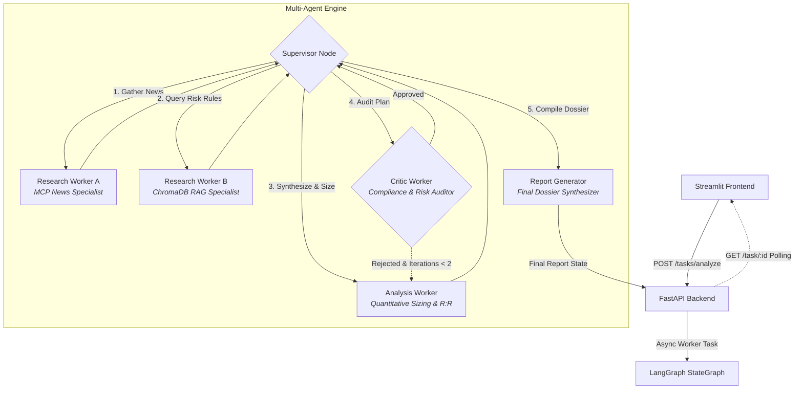

# ⚡ Trading Intelligence Assistant

An autonomous, multi-agent financial intelligence and risk management platform orchestrated with **LangGraph**, **FastAPI**, **Streamlit**, and the **Model Context Protocol (MCP)**. Powered by local LLMs via **Ollama** and a **ChromaDB** RAG knowledge base.

---

## 📌 Overview

**Trading Intelligence Assistant** automates the preparation of comprehensive financial dossiers for Forex currency pairs and Equities. Rather than relying on a single prompt or monolithic LLM call, the platform coordinates specialized autonomous workers under a **Supervisor Agent** architecture.

The system performs:
1. **Real-time market sentiment retrieval** via an isolated MCP news service.
2. **Grounding in foundational risk management rules** via semantic retrieval over classic investment literature.
3. **Deterministic mathematical position sizing** adhering to institutional risk envelopes (strict 2.0% equity rule).
4. **Independent critic auditing & verification** with automatic re-planning loops.
5. **Dossier synthesis & real-time delivery** through an interactive Streamlit UI and asynchronous FastAPI backend.

---

## 🏛️ System Architecture



---

## 🤖 Multi-Worker LangGraph Team

| Worker | Role | Key Capabilities & Tools |
| :--- | :--- | :--- |
| **Supervisor** | **Orchestrator** | Manages conversation state, dynamically routes tasks, enforces workflow convergence, and handles critic retry cycles. |
| **Research Worker A** | **Market News Specialist** | Connects to an **MCP stdio server** (`FastMCP`) to fetch and summarize real-time news headlines from Yahoo Finance & Google News RSS feeds; determines macro market sentiment (`BULLISH`, `BEARISH`, `NEUTRAL`). |
| **Research Worker B** | **Fundamental Rules Specialist** | Queries an embedded **ChromaDB vector store** loaded with *Fundamental Analysis for Dummies* using HuggingFace embeddings (`all-MiniLM-L6-v2`) to extract capital preservation and defensive margin-of-safety rules. |
| **Analysis Worker** | **Quantitative Risk Analyst** | Performs asset classification (Forex vs. Equity), pip-value weighting ($6.70 for JPY crosses vs. $10.00 for USD crosses), exact lot/share sizing, strict 2.0% risk cap enforcement, and asymmetric Risk:Reward projection (1:1.5 to 1:3.0). |
| **Critic Worker** | **Compliance & Risk Guardrail** | Audits the proposed trade plan against maximum account risk parameters. Rejects any allocation exceeding the 2.0% loss envelope and requests immediate remediation. |
| **Report Generator** | **Dossier Synthesizer** | Assembles research findings, quantitative metrics, and audit results into an institutional-grade Markdown Trading Intelligence Dossier. |

---

## 🚀 Key Features

- **Decoupled Architecture**: FastMCP stdio server cleanly isolates external news scrapers from the agent core.
- **Strict Risk Management**: Mathematical formulas prevent capital overexposure by automatically scaling lot sizes to pip distances or stock share stops.
- **Local & Private**: Powered by **Ollama** (`llama3.2`) and local HuggingFace embeddings—no external proprietary API keys required.
- **Self-Correcting Loops**: LangGraph conditional edges enable the Critic to send flawed risk plans back for recalculation before publication.
- **Asynchronous Execution**: FastAPI handles tasks via `BackgroundTasks` with thread-safe LangGraph `MemorySaver` checkpointing.
- **Interactive UI**: Streamlit dashboard with real-time job status polling, live metrics (Macro Bias, Risk Envelope, Target Profit), and dual-view dossier rendering (Formatted vs. Raw Markdown).

---

## 📂 Project Structure

```plaintext
trading-intelligence-assistant/
│
├── app/
│   ├── mcp/                      # Model Context Protocol subsystem
│   │   ├── host/
│   │   │   └── adapter.py        # LangChain MultiServerMCPClient adapter
│   │   └── server/
│   │       ├── fetch_news.py     # Yahoo & Google News RSS scraper
│   │       ├── main.py           # FastMCP stdio server entry point
│   │       └── tools.py          # FastMCP tool registration (@mcp.tool)
│   │
│   ├── rag/                      # RAG knowledge base subsystem
│   │   ├── macro_rag.py          # Document loader, splitter, embeddings & ChromaDB
│   │   └── Fundamental Analysis for Dummies PDF.pdf # Knowledge source
│   │
│   ├── workers/                  # Specialized LangGraph agent nodes
│   │   ├── analysis.py           # Lot sizing & quantitative risk calculation
│   │   ├── critic.py             # Compliance verification & risk ceiling audit
│   │   ├── reporter.py           # Final Markdown dossier compiler
│   │   ├── research.py           # News (MCP) & Book Rules (RAG) workers
│   │   └── supervisor.py         # State machine router & supervisor logic
│   │
│   ├── graph.py                  # LangGraph StateGraph compilation
│   ├── main.py                   # FastAPI REST API & background task runner
│   └── state.py                  # Pydantic models & LangGraph TypedDict state
│
├── streamlit_app.py              # Streamlit frontend dashboard
├── requirements.txt              # Project dependencies
├── .env.example                  # Environment configuration template
├── .gitignore                    # Git ignore specifications
└── README.md                     # Documentation
```

---

## 🛠️ Prerequisites

1. **Python 3.10+** (Tested on Python 3.10 - 3.12)
2. **Ollama**: Download and install from [ollama.com](https://ollama.com/)
   - Pull the required model:
     ```bash
     ollama pull llama3.2:latest
     ```
   - Ensure the Ollama daemon is running:
     ```bash
     ollama serve
     ```

---

## ⚙️ Installation & Setup

1. **Clone the repository:**
   ```bash
   git clone https://github.com/peaceboii/trading-intelligence-assistant.git
   cd trading-intelligence-assistant
   ```

2. **Create and activate a virtual environment:**
   ```bash
   # Windows (PowerShell)
   python -m venv venv
   .\venv\Scripts\Activate.ps1

   # Linux / macOS
   python3 -m venv venv
   source venv/bin/activate
   ```

3. **Install dependencies:**
   ```bash
   pip install -r requirements.txt
   ```

4. **Configure environment (Optional):**
   ```bash
   cp .env.example .env
   ```

---

## 🚦 Running the System

To run the complete platform, start both the **FastAPI backend** and the **Streamlit frontend**.

### 1. Launch FastAPI Backend
```bash
uvicorn app.main:app --host 127.0.0.1 --port 8000 --reload
```
- Interactive API documentation will be available at: [http://127.0.0.1:8000/docs](http://127.0.0.1:8000/docs)

### 2. Launch Streamlit Frontend
In a separate terminal (with the virtual environment active):
```bash
streamlit run streamlit_app.py
```
- Open your browser at: [http://localhost:8501](http://localhost:8501)

---

## 🔌 API Endpoints

| Method | Endpoint | Description |
| :--- | :--- | :--- |
| `POST` | `/tasks/analyze` | Initiates an asynchronous multi-agent intelligence task. Returns a `task_id` with HTTP 202 Accepted. |
| `GET` | `/task/{task_id}` | Polls the current task status (`PENDING`, `RUNNING`, `COMPLETED`, `FAILED`) and fetches the completed dossier. |
| `GET` | `/docs` | Interactive Swagger UI documentation. |

### Sample Analysis Request:
```bash
curl -X POST "http://127.0.0.1:8000/tasks/analyze" \
     -H "Content-Type: application/json" \
     -d '{
       "symbol": "GBPJPY",
       "account_balance": 10000.0,
       "stop_distance": 25.0
     }'
```

---

## 📋 Sample Dossier Output

When an analysis task completes, the agent team generates a structured report:

```markdown
# TRADING INTELLIGENCE DOSSIER: GBPJPY
**Generated:** 2026-11-11 14:30:00 UTC  
**Audit Status:** PASSED (Score: 0.95)

---

## 1. Executive Summary & Strategy
* **Directional Bias:** BULLISH
* **Recommended Volume:** 1.19 Lots (25.0 pips SL)
* **Risk Envelope:** $200.00 (2.0% Maximum)
* **Risk/Reward Scenarios:**
  * **Conservative (1:2 R:R):** Target Return = **+$400.00**
  * **Asymmetric (1:3 R:R):** Target Return = **+$600.00**
* **Confidence Rating:** 88.0%

## 2. Evidence Interpretation
Sentiment: BULLISH. Risk envelope capped at $200.00 (2.0%). Sizing: 1.19 Lots (25.0 pips SL). 
R:R Targets -> 1:2 Target: +$400.00 | 1:3 Target: +$600.00.

## 3. Independent Source Retrieval
### Worker A (Macro & News Intelligence):
Identified positive economic catalysts with UK GDP growth and Bank of England monetary stance...
*References: GBPJPY Yahoo rss Feed, Mcp::fetch_macro_news*

### Worker B (Trading Rule & Protocol Retrieval):
Rule 1: Preserve capital by maintaining an uncompromising margin of safety.
Rule 2: Never risk more than 2% of total portfolio equity on an unhedged position...
*References: Fundamental Analysis For Dummies (ChromaDB), Ch. 5: Margin of Safety*

## 4. Compliance & Critic Audit
> all risk metrics pass internal compliance standards
```

---

## 🛡️ Risk & Compliance Disclaimer

> [!WARNING]
> This software is intended strictly for educational, research, and informational purposes. It is **not** financial advice, investment advice, or a recommendation to buy or sell securities, currencies, or digital assets. Quantitative models and LLM-generated outputs can hallucinate or fail to predict market shifts. Always perform your own due diligence and consult a licensed financial advisor before risking capital.

---

## 📄 License

This project is licensed under the [MIT License](LICENSE).
